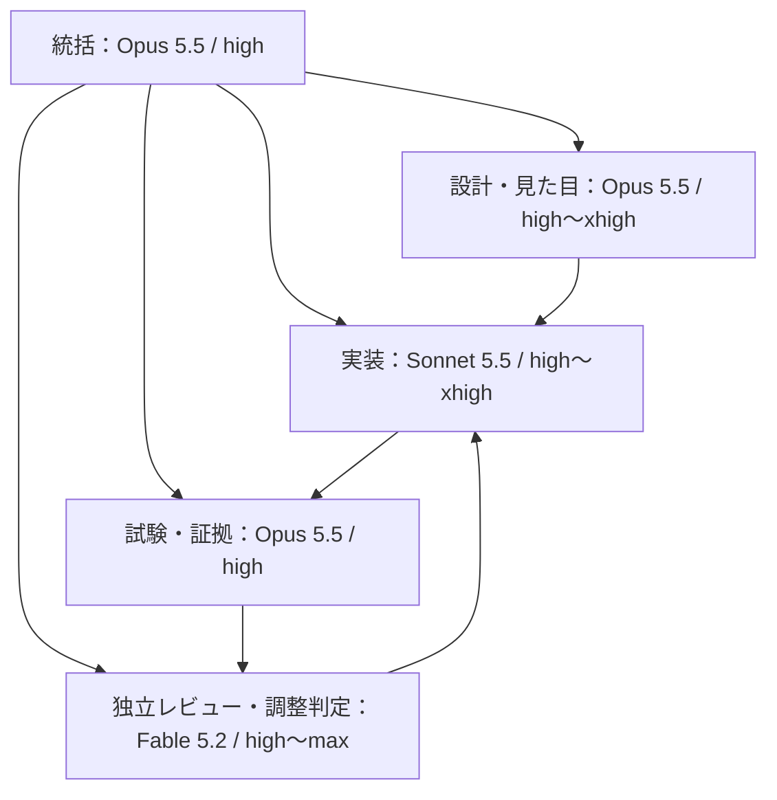

# Claude依頼文：カメレオるの輪郭・舌・称号と結果画像

以下は2026-11-14改訂3の実装依頼です。2棟刻みの追加20称号は正式な実装対象で、既存7名称と合わせて全27区分を実装します。旧文書の候補・保留の指示より本改訂を優先してください。

---

「カメレオる」の実装チームを運営し、指定資料の要件を実装・検証・独立レビュー・修正し、実装PRまで提出してください。描写と見た目を優先し、既存の採点・順位・出題・記録を守ってください。

## 最初に読む資料

対象：[chameleonjp-lab/chameleol](https://github.com/chameleonjp-lab/chameleol)。改訂3の資料ブランチは `docs/adopt-two-building-titles-20261114`、[未マージ時の取得先](https://github.com/chameleonjp-lab/chameleol/tree/docs/adopt-two-building-titles-20261114/docs)。開始時に文書head SHAと最新mainを記録してください。

1. `docs/superpowers/specs/2026-11-14-chameleol-design-followups-spec.md`
2. `docs/superpowers/plans/2026-11-14-chameleol-design-followups-plan.md`
3. `docs/reviews/2026-11-14-chameleol-design-followups-review.md`

実装基準mainは `ad5c595f54e0a14d604b20a98bf81ac147070940`（PR #19マージ後）。PR #14の補完演出、#16の5種ボーナス、#18のホーム色循環と巻きベロは取り込み済みです。古い未実装表記を根拠に作り直さないでください。

## 最新指示による除外と追加

E045の操作軌跡、E051の3棟物語、E088の再生、E097の発見帳は実装しません。対応するUI、再生時計、速度切替、軌跡購読、章情報、発見集合の保存も追加しません。原案番号は維持し、元80件＋今回16件＝採用96件とします。

代わりに結果画面の先頭を、一枚の結果カードへ変えます。画像の主人公は、本人が選択した「最高一致の1体」です。四つの主な要素は、ベスト棟の実際の体色の主人公、総スコア、通過棟数に応じた称号、特殊追加スコアの獲得件数です。画像を作る別操作を必須にせず、結果を表示した後に共有用PNGを準備し、主ボタン「Xでシェア」から使います。

## 担当組織とエフォート

| 担当 | モデルID | effort | 責任 |
| --- | --- | --- | --- |
| 統括 | claude-opus-5-5 | high | 依存・担当・進捗・統合・文書・PR |
| 構造と互換の設計 | claude-opus-5-5 | xhigh | 規則版、実色、表示成績、共有状態の契約 |
| 見た目の設計 | claude-opus-5-5 | high、競合が難しい時だけxhigh | 線、舌、称号、4要素カード、素材と余白 |
| 実装A | claude-sonnet-5-5 | T1はhigh、T2はxhigh | 輪郭→舌。ホームの回帰も担当 |
| 実装B | claude-sonnet-5-5 | T3はxhigh、T7はhigh、訂正競合だけxhigh | 静止結果解析、実色、称号、PNG、画像共有 |
| 実装C（枠を交代使用） | claude-sonnet-5-5 | high、複数タブ競合だけxhigh | 背景、警察、精密札、表示用保存 |
| 試験・証拠 | claude-opus-5-5 | high | 試験設計、実行、画像比較、端末手順 |
| 独立レビュー | claude-fable-5-2 | 初回計画max、工程差分high、最終統合max | 要件・互換・データ・見た目を別の文脈で検査 |
| 最終調整判定 | claude-fable-5-2 | xhigh | 実画像・数値から修正値と合否を決める |

Fableは修正内容・値・合否を判断し、製品コード・試験コード・素材生成コードは最後までSonnetが書きます。その他の設計・調査・試験実行・文書・進行管理はOpusです。実装担当が独立レビュー済みを自己認定しないでください。

モデル名の文章だけを作らず、各担当を指定モデル・effortで実際に起動してください。子担当も両方を個別指定し、親設定の継承に任せません。Claude Codeの担当定義なら `model: claude-sonnet-5-5` と `effort: high` のように指定し、難しい工程はxhighへ明示変更します。起動記録で上書きや上限も確認してください。

指定モデルが利用不可ならその工程を報告し、別モデルで代行したのに指定どおりと装わないでください。できる独立作業は続けます。新しい有料契約、追加クレジット、高速モードを勝手に有効化しません。

統括込み最大4担当、同時編集する実装担当は最大2名です。app.js/street.js/result-view.js/catalog.jsは各時点一人だけが編集します。T8の保存契約をT4/T6より先に完成し、T3の結果データとT1のモデル調整の後にT7をつなぎます。

## 実装する内容

### 輪郭と舌

輪郭は1〜10棟を最も薄く細くし、11〜15、16〜20、21〜25、26〜30、31〜35、36〜39、40〜50の8段階。40棟から太さ0.085・RGB各0.1059の現行値です。36〜39だけ4棟なのは40棟開始を優先する解釈です。目・鼻・口や警察、比較面の色は変えません。対象棟を使い、ガイドのsceneTから推測しません。

移動の10秒、20秒、30秒…に舌へダイヤを乗せます。準備150・伸長250・保持350・収縮450・収納200ms。停止・非表示・静止ガイド・描画停止を加算せず、割込みで抑止された機会はまとめ再生しません。再読込復帰では見た目の時計を0から始めます。既存ホームの24色・12秒周期と900msの不定期な舌は維持します。

### 称号と最高一致の主人公

称号は今回の確定通過数だけで決めます。既存7名称とキーを残し、追加20件を正式採用した次の27区分を実装してください。0・1・50棟は特別区分、それ以外は2棟ずつです。

| 通過棟数 | rankKey | 称号 |
| --- | --- | --- |
| 0 | beginning | かくれんぼ入門 |
| 1 | apprentice | 見習いカメレオン |
| 2〜3 | tier_02_03 | 色合わせの練習生 |
| 4〜5 | tier_04_05 | 壁ぎわの隠れ上手 |
| 6〜7 | tier_06_07 | 路地の忍び足 |
| 8〜9 | tier_08_09 | 追跡かわしの新顔 |
| 10〜11 | alley | 路地の隠れ上手 |
| 12〜13 | tier_12_13 | 裏道のすり抜け役 |
| 14〜15 | tier_14_15 | 色変わりの手品師 |
| 16〜17 | tier_16_17 | 追手泣かせの隠れ役 |
| 18〜19 | tier_18_19 | 壁になりきる役者 |
| 20〜21 | expert | 街の擬態名人 |
| 22〜23 | tier_22_23 | 街角の変装名人 |
| 24〜25 | tier_24_25 | 色をまとう怪盗 |
| 26〜27 | tier_26_27 | 警察泣かせの怪盗 |
| 28〜29 | tier_28_29 | 追跡をかわす達人 |
| 30〜31 | elusive | 変幻自在の逃走者 |
| 32〜33 | tier_32_33 | 気配を消す名手 |
| 34〜35 | tier_34_35 | 夜道に溶ける影 |
| 36〜37 | tier_36_37 | 包囲を抜ける怪盗 |
| 38〜39 | tier_38_39 | 姿なき逃走者 |
| 40〜41 | phantom | 幻の宝石泥棒 |
| 42〜43 | tier_42_43 | 月夜の大怪盗 |
| 44〜45 | tier_44_45 | 街をあざむく幻 |
| 46〜47 | tier_46_47 | 追いつけない残像 |
| 48〜49 | tier_48_49 | 伝説目前のカメレオン |
| 50 | legend | 伝説のカメレオン |

全27キーを15言語・rankForPassed・結果画面・共有PNGへ同じ内容で反映し、追加20件を候補として保留しないでください。旧7区分の範囲はこの表へ置き換えます。表示する称号は1つで、能力・採点・順位を変更しません。

最高一致の棟は、通過済みの棟平均を丸めず比較し、同率は早い棟です。主人公はその棟の評価中に正の時間を持った最高瞬間一致の実HSVを使います。既存No.28モデルを1体だけ大きく載せ、壁色や平均値から体色を創作しません。0棟・履歴なしでは初期色と「一致度の記録なし」を示します。

### スコアと特殊追加スコア件数

総点は既存applyVerifiedScore後の表示用成績から取り、署名元summaryを変更しません。「ボーナス獲得 ○件」は精密・安定・10棟到達・素早い色合わせ・全棟成功の5種の獲得回数合計です。種類数や点数ではありません。精密5/10点は択一で1件、通常点は含めません。現行の完全成功例は156件・7280点を別々に検算します。対応版の0と旧版の記録なしを区別します。

### 一枚の画像とXへの共有

主カードは1200×630 PNGを初期寸法とし、左に主人公、右に称号とスコア、下に通過棟数と件数。同じdrawResultCardの描画元を結果画面とPNGへ共用します。画像ごとにAI生成を呼ばず、既存モデルの静止画像と正確な文字・数値をCanvasでまとめます。

結果の表示後、フォントと画像が揃ったらPNGを先に生成し、現在revisionのFileを1枚保持します。「Xでシェア」のタップ内でファイル対応を確認し、iPhoneの共有画面へPNG・短文・正式URLを渡します。共有先にXがある時に利用者が選び、X投稿画面に画像が添付されることを実機で確認します。端末共有の成功を投稿成功と扱いません。

タップ後の長い画像生成、画像なしへの無言の切替、自動投稿は行いません。X候補一覧や選択結果を取得できる前提にしません。取消と共有先なしが同じAbortErrorになる場合は中立的に復帰し、利用者がXを見つけられず戻った場合にも「画像を保存」「本文でXを開く」を明示操作で選べるようにします。ホームのX共有は本文とURLを維持します。X用の新認証やサーバー投稿、追加課金をこの依頼から導入しません。

公式訂正・得点を変えない確認状態の変化・言語・結果・レイアウトの変更でrevisionを増やし、旧解析・旧画像を破棄します。未確定の順位・内部ID・照会用秘密・名前はカードへ追加しません。主成績と再プレイは画像準備を待たせません。正常終了・保存失敗・旧版途中再開のいずれもsession破棄前に表示専用contextを確保して実色を渡し、同じ結果の再表示にも使います。

### 残る16案と後続確認

E020/E034/E039/E044/E056/E067/E068/E069/E072/E075/E076/E084/E086/E087/E090/E094を要件表どおり実装します。E094は今回の主カードへ統合します。E072等に必要な静止資料の解析は残しますが、E088の操作できる再生機能は作りません。

中間配達の回数1枠は開始時から予約し、110000〜126500msは時間枠も空けます。回数は表示用に保存し、再読込で0へ戻しません。小芝居・粒子・画像の上限は新旧合計です。品質を落とす必要がある場合は具体的な代替と失う体験を示し、他の作業を続けます。

FOLLOW-01〜08として、古い文書、実機候補、iPhoneの縦横・音・復帰・X添付、旧記録と旧版再開、正式値の材料、警察原画、本番との差分、96採用/4除外の対応表を揃えます。実機未確認や原画不足を推測で完了にしません。

## 検証と提出

最初にOpusが改訂3と現行コードを照合し、Fableが計画を敵対的に確認します。重大・重要を反映してからSonnetがT0〜T9を実行します。対象試験→Opusの証拠→Fableの差分レビュー→Sonnetの修正→再確認の順です。

重点は、除外4件の再混入、全27称号と全51通過数の一意な対応、称号境界、ベスト棟と実色、156件と点数の区別、旧版missing、公式訂正後の古い画像、共有の操作直後制約、取消・失敗、主成績と再プレイの維持です。指摘には再現・影響・修正先・試験/画像・再確認結果を残します。

工程ごとは対象試験、最後のコード変更後は全単体・ビルド・全ブラウザを一度完了します。既存CIを弱めず、期待値変更やskipで失敗を隠しません。3寸法の画像とiPhoneのX添付は別の証拠です。

提出は実装PR、要件別の証拠、3寸法の実画像、実機の状態、未解消項目と不足情報です。mainへ直接push・本人に代わるマージ・スコア初期化・再帰削除・本番DB変更・無断公開・実験場掲載は行いません。

---

モデル設定の根拠：[モデル一覧](https://platform.claude.com/docs/en/models/overview)、[effort](https://platform.claude.com/docs/en/build-with-claude/effort)、[モデル設定](https://code.claude.com/docs/en/model-config)、[子担当設定](https://code.claude.com/docs/en/sub-agents)。役割と並行数は本件の設計判断です。共有の根拠：[W3C](https://www.w3.org/TR/web-share/)、[WebKit](https://webkit.org/blog/13862/the-user-activation-api/)。特定端末でのX添付は別途実機確認します。
