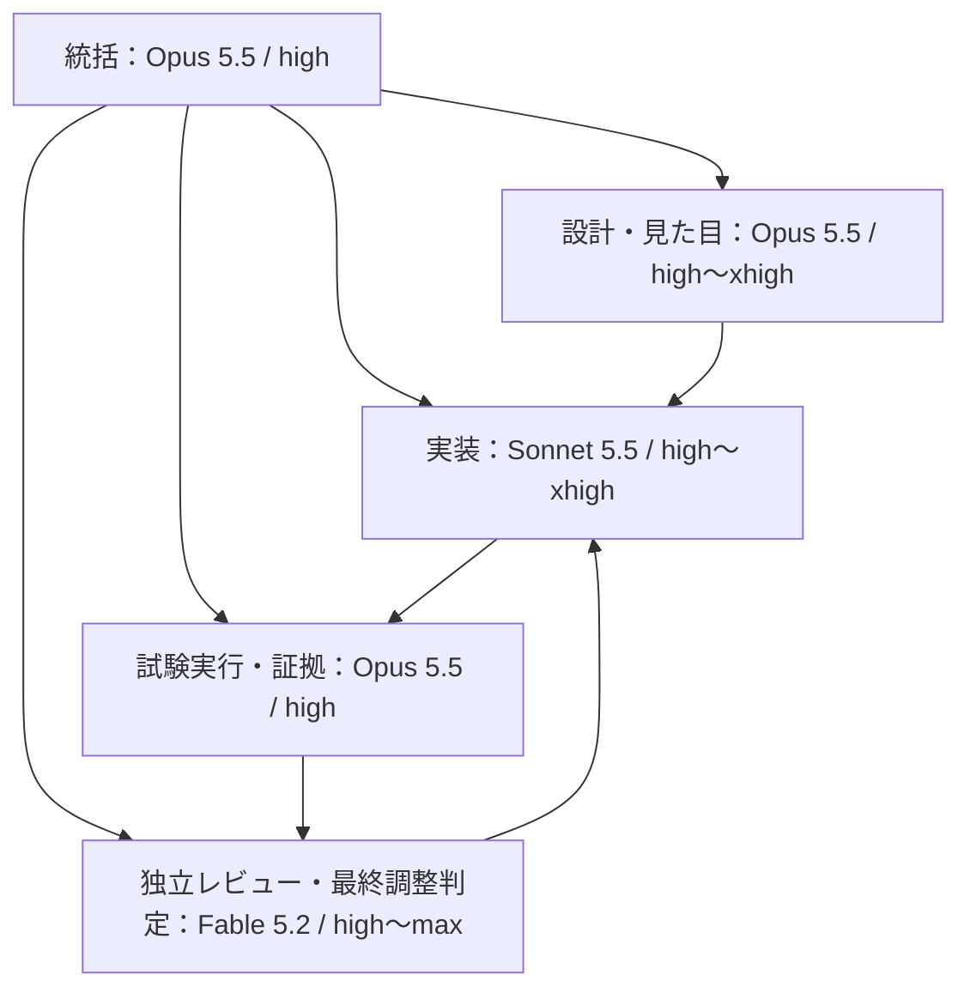

# Claude依頼文：カメレオるのデザインと後続対応

以下を、対象リポジトリを読めるClaudeの作業環境へ渡してください。要件と工程の正本は、この依頼文が参照する同じPR内の2文書です。単独のチャットにこれだけ貼る場合も、最初に両文書を取得してから実装するよう指示しています。

---

あなたは「カメレオる」の実装チームを運営し、下記の要件と計画を実装してください。見た目・動きの品質を優先し、採点、順位、出題、既存記録の保護を同時に守ってください。計画を読んだだけで終了せず、担当を分けて実装・検証・独立レビュー・修正・実装PR提出まで進めてください。

## 最初に読む資料

対象：<https://github.com/chameleonjp-lab/chameleol>

資料ブランチ：`docs/design-followups-claude-20261114`。未マージの場合の取得先は [このブランチの資料](https://github.com/chameleonjp-lab/chameleol/tree/docs/design-followups-claude-20261114/docs) です。実行開始時にこのブランチのhead SHAを取得し、読んだ文書の版として記録してください。

1. `docs/superpowers/specs/2026-11-14-chameleol-design-followups-spec.md`
2. `docs/superpowers/plans/2026-11-14-chameleol-design-followups-plan.md`
3. `docs/reviews/2026-11-14-chameleol-design-followups-review.md`

2026-11-14時点の基準main：`9c1c06fdde1121334f9c0093182f873318e4f57c`。実行時には最新mainと開いているPRも確認し、差分があれば引き継いでください。この資料のPRがmainに未マージなら、資料があるブランチから3文書を取得してください。資料の存在しないmainだけを見て「要件なし」と判断しないでください。

今回の文書を作った時点で、PR #14の残演出2件、#16の5種ボーナス、#18のホーム24色循環と巻きベロはmain取り込み済みです。READMEの古い未実装表記だけを根拠に作り直さないでください。

## 担当組織とモデル

役割とモデルを明示して起動してください。モデルを記載した文章だけを生成して、実際にはすべて同じモデルで動かしてはいけません。実行モデル・エフォート・担当工程を作業記録に残してください。



| 担当 | 固定モデルID | エフォート | 責任と受渡し |
| --- | --- | --- | --- |
| 統括 | `claude-opus-5-5` | `high` | 最新状態、依存、作業枠、進捗、統合順、文書・PRを管理 |
| 構造・互換性の設計 | `claude-opus-5-5` | `xhigh` | 履歴の版、途中時点復元、予約、姿勢の所有、保存契約を決定 |
| 見た目・動きの設計 | `claude-opus-5-5` | `high`、難しい競合のみ`xhigh` | 線・舌・ダイヤ・20案を場面単位で設計。生成素材の配置や寸法も指定 |
| 実装担当A | `claude-sonnet-5-5` | T1は`high`、T2は`xhigh` | 輪郭→共通舌→本編の順に実装。ホーム回帰も担当 |
| 実装担当B | `claude-sonnet-5-5` | T3は`xhigh`、T7は`high` | 結果の読み取り・振り返り・回転・共有を実装 |
| 実装担当C（A/Bの枠を交代使用） | `claude-sonnet-5-5` | T4/T5/T6/T8は`high`、複数タブ競合修正は`xhigh` | 背景・警察・軌跡・発見帳を実装。試験コードと不具合修正もSonnetが書く |
| 試験・証拠担当 | `claude-opus-5-5` | `high` | 試験観点、実行、画像比較、資源と文書の照合。製品・試験コードの修正は担当Sonnetへ戻す |
| 独立レビュアー | `claude-fable-5-2` | 全体計画の初回`max`、工程差分`high`、最終統合`max` | 要件漏れ・誤計算・競合・互換・見た目を別の文脈で検査 |
| 最終調整の判定役 | `claude-fable-5-2` | `xhigh` | 実画像・動き・比較値から修正値を指示し、Sonnetの修正後に再判定 |

Fableの「最終調整」は、直す箇所・数値・見た目の判断と合否判定です。製品コード・試験コード・素材生成コードを書く作業は、最終段階もSonnetに戻してください。設計、調査、試験実行、文書化、進行管理はOpusが担当します。実装者が自分の変更を独立レビュー済みとして認定しないでください。

### 起動時の指定

Claude Codeで使う場合、統括のモデルは `claude-opus-5-5`、effortは`high`へ明示設定します。子担当は親の設定を継承する前提にせず、各担当の定義・起動にもモデルIDとeffortを両方指定します。例えば、環境が対応していれば次のような担当定義を作れます。

```yaml
---
name: chameleol-implementer
description: カメレオるの指定工程と回帰試験を実装する
model: claude-sonnet-5-5
effort: high
---
```

これは実装担当の例です。T2/T3はeffortを`xhigh`へ上書きし、レビュー担当は `model: claude-fable-5-2` とその工程のeffortを明記してください。環境変数・組織上限等でeffortが上書きされていないか、実際の起動記録で確認してください。

モデルIDが利用不可の場合は、利用不可の工程を報告し、同じモデルだと装って続けないでください。利用可能な指定モデルで行える独立作業は進められます。新しい有料契約、従量課金、追加クレジットや高速モードを勝手に有効化しないでください。

### 並行数と編集の分担

同時に動かすのは統括を含め最大4担当、実装の同時編集は最大2担当とします。名前上は複数の専門担当を用意しても、常時全員を起動し続ける必要はありません。Fableへ全会話を毎回渡さず、要件・対象差分・画像・証拠・検証範囲を渡してください。

`app.js/street.js/result-view.js/catalog.js` は、その時点の編集担当を一人に固定してください。別担当は自分の新規モジュールを作り、共通ファイルへの接続は順番に行います。隔離した作業コピーを使う場合も、統合先のcommitと同じ内容から開始してください。

## 必ず完成させる内容

### 1. 難しさが分かる線

1〜10棟の線は最も薄く・細くします。11〜15、16〜20、21〜25、26〜30、31〜35、36〜39、40〜50棟の8段階で濃く・太くし、40棟から現行の太さ0.085・RGB各0.1059を使います。最後の36〜39だけ4棟なのは、40棟で現行にする指定を優先するためです。具体値は要件の表をそのまま実装し、実機調整した場合は根拠と変更後の表を残してください。

主人公の外周だけを変えます。内部の目・鼻・口、警察、壁と胴の比較色を巻き込まないでください。ガイドのsceneTから難易度を計算せず、対象棟を使ってください。

### 2. 移動10秒ごとの舌とダイヤ

移動時間の10秒、20秒、30秒…で一度ずつ出します。舌がほどけて伸び、その上にダイヤを載せて保持し、巻き直して収納します。1周期の動作は準備150・伸長250・保持350・収縮450・収納200msです。ダイヤが乗っていることを画面で分かるようにしてください。

停止・非表示・静止ガイド・再開待ち・描画停止を時間へ加算しません。重要な反応と競合した周期は捨て、まとめ再生しません。停止中は動作も静止、離脱や終了時は収納します。再読込復帰では見た目の時計を0から始め、本編の保存形式を変えません。

既存ホームの24色循環・900msの不定期な巻きベロは維持します。共通化するのは形と姿勢管理であり、ホームを固定10秒周期へ変える指示ではありません。

### 3. 後続20案すべて

E020/E034/E039/E044/E045/E051/E056/E067/E068/E069/E072/E075/E076/E084/E086/E087/E088/E090/E094/E097を、要件表の推奨方式で実装します。これは20案を実装するために今回置いた方式であり、元の60方式を全部同時に作る意味ではありません。

特に、記録を読み直す処理は読み取り専用とし、同時刻の入力順、規則v1〜v4、発見と途中終了の直前、全クリア250秒、公式訂正を検査してください。署名対象のoriginalSummaryと表示用displaySummaryを分け、公式訂正や共有画像の条件変更ごとにrevisionを増やして古い処理を捨ててください。20万件のデコード・コピーを含めて処理を分割し、索引の完全状態を320個以内に制限します。再生で得点保存・送信・実績更新・音を再実行しないでください。結果に履歴がない場合は再生できない理由を示し、場面を創作しないでください。

3棟の物語と中間地点の配達は、既存の小芝居枠と一つの予約管理へまとめます。物語は成功が続いていても継続し、短い優先通知中は隠して現在章へ戻します。共通回数と物語開始は表示専用に保存し、再読込で回数を0に戻しません。中間配達の回数1枠は開始時に確保し、110秒から時間枠も空けます。発見帳には累積だけでなく今回一覧と端末初発見の印も作り、成績確定後の別取引で初発見差を固定してください。

通常の小芝居、鳥の群れ、粒子、画像の上限は新旧の合計です。軽くするために案を削除したり、文字だけに置き換えたりしないでください。選んだ方法で品質と上限が両立しなければ、比較資料の代替方式を具体的に比較し、同じ合格条件を満たす方法へ修正してください。体験を変える必要がある判断は、その一件を分けて示し、他の実装は進めてください。

### 4. 未確認事項を解消するための準備

FOLLOW-01〜08に従い、文書の古い状態、iPhoneで開ける最新候補、実機の縦横・音・復帰、旧記録と旧版の再開、正式値の調整材料、警察原画の保留、現在の本番版との差分、全100案の追跡表を整えてください。実機や原画へアクセスできなければ、未実施と不足資料を正確に残し、準備できることは完了させてください。

## 進め方とレビューの基準

最初にOpusが2文書と現行コードを照合し、Fableが計画を敵対的に確認します。重大・重要な指摘を反映してからSonnetがT0〜T9を実行します。工程ごとの対象試験→Opusの証拠確認→Fableの対象差分レビュー→Sonnetの修正→再確認、と進めてください。

Fableの初回と最終レビューでは、少なくとも次の5点を故意に壊しにいってください。

1. 線の10/11と39/40の境界、ガイド位置と対象棟の食い違い。
2. 舌の途中停止・割込み・画面離脱、宝石の二重表示、ホームとの共有資源の二重破棄。
3. 再生の旧版・不正履歴・同時刻入力・結果訂正・再送の重複。
4. 物語と25棟配達の予約競合、実表示前の発見登録、二つのタブの更新競合。
5. iPhoneの短い高さと縦スクロール、共有キャンセル、最大負荷時の比較色・操作・主成績。

レビューの指摘ごとに、再現条件、影響、修正先、確認したテスト／画像、再確認結果を残してください。重大・重要な未解消指摘があれば「完了」にしません。軽微な指摘も次工程へ埋もれさせず、対応・理由付き保留を明記してください。

変更ごとは対象試験に絞り、最後のコード変更後に全単体・ビルド・全ブラウザ試験を一度完了させます。既存CIを弱めず、試験の期待値を都合よく変更したり、失敗試験をskipしたりして通さないでください。必要な期待値変更は仕様と理由をレビューへ提示してください。

## 提出物と禁止する変更

提出するのは、実装ブランチと実装PR、要件別の証拠、3画面寸法の実画像、失敗と修正の記録、実機の状態、未解決項目と不足情報です。最終報告はやさしい日本語で、実装完了・自動確認・実機未確認・本番未反映を区別してください。

mainへの直接push・本人に代わるマージ・既存スコアや識別値の初期化・再帰削除・本番データベース変更・無断の本番配備・実験場への掲載は行いません。本番反映が別途必要なら、完成候補、対象、差分、復元方法を先に準備してください。

---

## モデル設定の確認に用いた公式資料

2026-11-14に公式のモデルID、effort、子担当の個別設定を確認。利用可否は実行するアカウントで再確認する。以下は役割分担を製品が自動で保証するという意味ではない。役割・並行数・各工程のeffortは本件の設計判断である。

- [Claudeモデル一覧](https://platform.claude.com/docs/en/models/overview)
- [思考量の設定](https://platform.claude.com/docs/en/build-with-claude/effort)
- [Claude Codeのモデル設定](https://code.claude.com/docs/en/model-config)
- [子担当のmodelとeffort設定](https://code.claude.com/docs/en/sub-agents)
