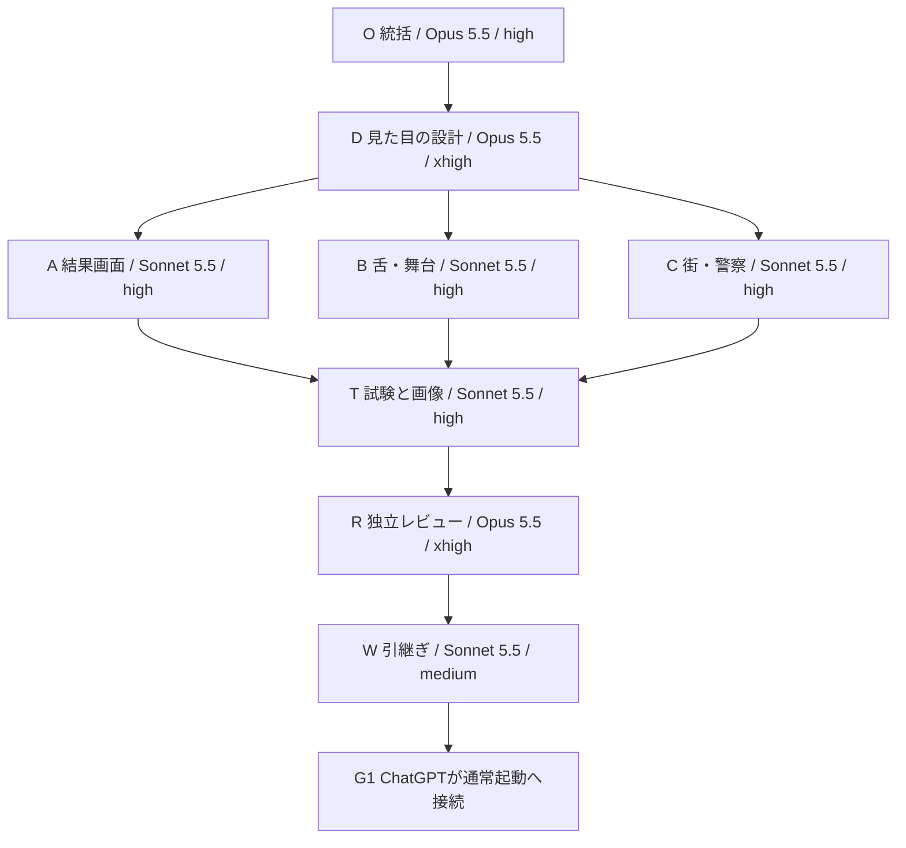

# カメレオる：PR #21後の後続対応 Implementation Plan

> **For agentic workers:** P0〜P6の役割・編集担当・同時4人の上限に従う。実装はA/B/Cで並行し、複数担当を利用できない場合だけ同じ順序で逐次実行する。古い逐次実行の指示でこの体制を置き換えない。本人指定のClaude／ChatGPT分担を維持する。

**Goal:** PR #21で入った部品を引き継ぎ、残る修正・演出・27称号の結果カード・画像共有を、Claudeの画面実装とChatGPTの仕様処理に分けて完成させる。

**Architecture:** ChatGPTが判定・表示用データ・時計・保存取得・共有状態を実装し、Claudeは読み取り専用の値を受けて画面と動きを実装する。app.jsで接続し、仕様の条件を画面内へ二重実装しない。

**Tech Stack:** JavaScript ES modules、Node.js 20以上、Three.js 0.170.0、既存IndexedDB、Canvas 2D、node:test、既存Playwright。

**Spec:** [今回の分担・接続仕様](../specs/2026-11-15-chameleol-role-contract.md)、[既存改訂3の要件](../specs/2026-11-14-chameleol-design-followups-spec.md)、[PR #21の実装レビュー](../../reviews/2026-11-14-chameleol-design-followups-implementation-review.md)。Claudeへは[画面実装専用の依頼文](../../prompts/2026-11-15-claude-visual-followups.md)を渡す。

2026-11-15初版、**2026-11-16（日本時間）Claude実行体制を追記**。今回の開始基準は#24取り込み済みmain `f4206a484d058f02204da9c401361538853f0750`。#23の実装head `38cd3a517581ff76d8252dcbf9364e919bb1828d` は#22の作業ブランチへマージされ、開始時点のmainには未反映だったため、今回のPRでその実装を引き継ぐ。#24の4組並行CIは保持する。

C0〜C4の節は初回の実装手順を残したもの。現在の進行状況は直下の「2026-11-16の開始状態」を優先し、処理を再実装しない。V1〜V4の画面、G1の通常起動経路への最終接続、G2の実機・公開は未完了。今回のPRには既存#23の処理と本書等の改訂を含むが、新しい画面は実装しない。

初版のレビューは[2026-11-15の記録](../../reviews/2026-11-15-chameleol-post-pr21-plan-review.md)、今回の実行体制の独立レビューと修正は[2026-11-16の記録](../../reviews/2026-11-16-claude-execution-plan-review.md)に記載する。

## Global Constraints

- 全50棟、既存の採点・順位・出題・履歴・署名summary・送信内容・識別値を維持する。
- 規則v1〜v4、DB_VERSION=1、既存ストアと未送信結果を維持する。表示専用の処理から得点を書き換えない。
- 採用は元80件＋後続16件＝96件。E045・E051・E088・E097の4件は除外する。
- Node.js 20以上、Three.js 0.170.0、既存の15言語を維持する。新しい実行時依存は必須にしない。
- 自動画像は402×700、402×874、874×402で作り、自動ブラウザと実機の結果を分ける。
- 街7枠、静的装飾24、小芝居1組3枚、環境粒子8、成功リング1、追加描画呼出12・形16・画像4、圧縮画像1.5MiB・展開後16MiBを新旧合計で守る。
- 表示保存は32KiB・直近32playId以内を維持する。追加課金やCodex Cloudの実装ジョブは起動しない。
- mainへの直接push・本人に代わるマージ・記録初期化・本番データベース変更・無断公開・実験場への掲載は行わない。

## Review Focus

| 条件 | 期待する動作と担当工程 |
| --- | --- |
| 解析中の再プレイ・画面離脱と遅い完了 | C1/C3：即座に本編へ移り、古い解析・画像を採用しない |
| 得点が変わらない確認状態の変更・言語切替 | C3/V4：古いFileを使わず、15言語の切替で主人公を撮り直さない |
| 旧版・不正な棟数・ベスト棟だけ実色欠損・壊れたボーナス | C2：確認中／記録なしを出し、次点や壁色から埋めない |
| 取得が遅い・複数タブ・中間配達の期限をまたぐ | C4/V3：取得成功前には描かず、成績・再開・入力を止めない |
| 短い縦画面・横画面・警察1人の振り向き・画像保存表示 | V2/V4/G1：比較面・操作領域・8px余白・16MiBを守る |

## 2026-11-16の開始状態

| 対象 | 今回のPRで引き継ぐ状態 | 次に行うこと |
| --- | --- | --- |
| #22の仕様と計画 | mainへ反映済み | 要件とChatGPT／Claudeの分担を保持 |
| #23 C0〜C4 | 実装headを本PRへ取り込む。既存の判定・共有制御・保存口・15言語を使用 | Claudeはこの処理を呼び出す画面を作る。処理自体を作り直さない |
| #24 CI | mainへ反映済み。checks＋ブラウザ4組＋最後のtest | 途中は対象試験、提出前はこのCIを1回完了。新規のe2eファイルも自動対象 |
| V1〜V4 | 未実装。#23は描画部品の接続口まで | 本節の実行体制で実装・画像確認・PR提出 |
| G1 | ChatGPT担当として残る | 結果の通常起動への接続と96採用／4除外への切替、実データでの全体検証 |
| G2 | 実機・公開確認は残る | iPhoneで開ける候補と確認手順、配布差分を用意。公開は別の依頼・計画と照合 |

#23単独の最終CIは単体530成功／失敗0／DB専用skip31、サーバー処理32/32、ブラウザ209/209を記録している（[実装証拠](../../acceptance/chatgpt-pr23-evidence.md)）。#24単独の実測19分19秒→7分34秒は、その当時の207件の比較である。今回の組合せの結果は今回のPRのCIで確認し、過去の件数・時間で代用しない。

### 実装組織とモデル・エフォート

エフォートは、モデルが検討に使う深さの設定。以下は今回の作業への指定であり、公式の一律推奨値ではない。**統括と設計はOpus 5.5、製品コードと試験の実装はSonnet 5.5**を使う。独立レビューは実装者と別の担当・新しい文脈で行う。

| 役割 | 指定モデル | effort | 責任と成果物 |
| --- | --- | --- | --- |
| O：統括・競合整理 | `claude-opus-5-5` | `high` | 要件・優先順位、担当範囲、進行表、共通ファイルの編集順、PRと残件 |
| D：見た目・画面の設計 | `claude-opus-5-5` | `xhigh` | 配色・構図・動作・余白・3寸法・長い翻訳・資源配分を先に決め、A/B/Cへ渡す。製品コードは書かない |
| A：結果パネルと結果カードの実装 | `claude-sonnet-5-5` | `high` | V1→V4、Canvas描画・主人公撮影・模型・回転パネル・共有/保存の画面・共通CSS |
| B：主人公の舌と舞台側の描画接続 | `claude-sonnet-5-5` | `high` | V2、舌・ダイヤ・姿勢、street/stageの描画側接続、Cの描画部品を舞台へ組み込む |
| C：街・警察・精密札の実装 | `claude-sonnet-5-5` | `high` | V3、街の素材・警察動作・通知の見た目。舞台へ渡す独立した描画部品と配置可否 |
| T：試験の実装・画像/数値の記録 | `claude-sonnet-5-5` | `high` | 条件別の試験、3寸法の画像、比較色・余白・資源数、旧版・共有・停止の証拠 |
| R：独立した設計/実装レビュー | `claude-opus-5-5` | `xhigh` | 重要な欠落・競合・値の二重判定・描画負荷・画像と操作の不一致を検査。製品コードは変更せず、指摘を実装担当へ返す |
| W：証拠の整理と引継ぎ | `claude-sonnet-5-5` | `medium` | 要件ID→ファイル→試験→画像の対応、実機/未接続/未公開の区別、ChatGPTへの受け渡し票 |



役割の数だけ同時に起動しない。**統括を含め同時4人まで**。最初はO＋D、設計が定まったらO＋A＋B＋Cで並行する。終了した実装担当の枠をT、次にR、Wへ回す。T/R/Wを追加して上限を超えない。独立レビューの指摘修正はSonnetの元の実装担当へ返し、変更した範囲を再確認する。

同じ担当者の自己点検を独立レビューと書かない。利用環境が複数担当を起動できない場合は、実際に利用できるモデルと設定を記録したうえで同じ役割順に実行する。指定モデルが使えない場合や設定が制限されている場合は、その事実と候補を返し、使ったことにしない。追加課金や別の外部APIを起動して補わない。

### モデル設定の方法と出典

2026-11-16に[モデル一覧](https://platform.claude.com/docs/en/models/overview)、[Claude Codeのモデルとeffort](https://code.claude.com/docs/en/model-config)、[サブエージェントのmodel/effort](https://code.claude.com/docs/en/sub-agents)を確認した。モデルIDは上表を固定値にし、版が変わり得る`opus`/`sonnet`の別名だけで記録しない。

Claude Codeを起動できる環境での統括の設定例は `claude --model claude-opus-5-5 --effort high`。各担当にはモデルIDとeffortを個別に指定する。定義ファイルを使う場合は、そのファイルの冒頭に次のように記述する。

```yaml
---
name: chameleol-result-visual-implementer
description: カメレオるのV1とV4の画面実装を担当する
model: claude-sonnet-5-5
effort: high
---
```

モデルを変えると親のeffortがそのまま引き継がれるとは限らない。`CLAUDE_CODE_EFFORT_LEVEL`がある場合は個別指定より優先されるため、値の有無と実際に適用された設定を記録する。環境変数や組織の設定を勝手に書き換えない。個別設定を使える機能はClaude Codeの版で異なるため、認識された設定を確認する。本文にモデル名を書くことだけで切替済みと扱わない。ブラウザ版等で同じ操作ができない場合も、利用できた機能だけを記録する。

### 編集するファイルを分ける

| 編集場所 | Claude内の担当 | 同時編集を避ける方法 |
| --- | --- | --- |
| `result-evidence-view.js`、結果の新規描画4ファイル、`presentation.css`、結果アトラス | A | CSSと結果アトラスはAだけ。Cの通知用CSSは追加する規則をAへ渡す |
| `tongue-rig.js`、`travel-tongue.js`、`showcase-tongue.js`、`street.js`、`stage.js` | B | `street.js`と`stage.js`はBだけ。Cの描画呼出・配置可否をBが取り込む |
| `street-accents.js`、`actor-reactions.js`、`characters.js`、`hud-view.js`、`bonus-view.js`、街アトラス | C | Bの主人公姿勢との変更箇所を先に共有し、同じ関数へ同時に修正を入れない |
| 各対象の試験 | 実装担当→T | 実装担当が対象ファイルを返してからTが追加する。試験ファイルの二重編集をしない |
| `src/app.js`、C1〜C4の処理、15辞書、`catalog.js`の採否、保存・通信・規則 | ChatGPT | Claudeは変更しない。必要な接続差分や翻訳キーは受け渡し票へ記す |

同時作業は別の作業コピーで行い、Oが取り込み前に差分を照合する。作業コピーを作る機能が既定ブランチから開始する場合もあるため、全担当の開始commitがこの計画更新PRを含む同じcommitであることを確認する。

### Claudeの実行工程と合格条件

| 工程 | 担当・開始条件 | 実装と合格条件 |
| --- | --- | --- |
| P0 最新状態の照合 | O／この計画更新PRを本人がmainへマージ後 | #23の処理ファイル、#24の4組CI、現行の計画・分担仕様・接続票を確認。C0〜C4を再実装しない |
| P1 見た目を決める | D／P0後 | No.28、既存の輪郭・街・結果の見た目を引き継ぐ。3寸法と15言語、カード1体、描画と画像の上限を満たす配置と姿勢をA/B/Cへ渡す |
| P2 並行して実装 | A＝V1→V4、B＝V2、C＝V3／P1後 | 下記V節の全条件を実装。計算は#23の処理を呼び、結果の実色や称号、舌の時刻、抽選、精密札を画面側で再判定しない |
| P3 描画側を組み合わせる | BがCを舞台へ、Aが結果を組合せ／各部品後 | `stageFactory`に渡る`gameExtrasController`を既存の描画フレーム内で1回だけ呼ぶ。`args.presentation.t`を使用し、sceneTと混同しない。旧directorとの二重抽選をしない |
| P4 実際のAppと接続試験 | A/B＋T／P3後 | 結果は`new App(root,{resultCardPorts})`を使う試験経路で実際の値と接続し、描画用モックだけで合格にしない。通常起動が`new App(root)`のままである点はG1未接続として明記 |
| P5 独立レビューと修正 | R→A/B/C→T／P4後 | 3寸法の画像・15言語・旧版・欠損・再プレイ・警告/ガイド・停止・共有取消・資源数を照合。重要指摘は修正と再確認後にPRへ含める |
| P6 ChatGPTへ提出 | O＋W／P5後 | 変更ファイル、実際のexport、ports生成と呼出例、対象commit、試験・画像・測定、未接続一覧を1枚の受け渡し票にまとめる。G1用PRとして提出し、マージは本人へ委ねる |

精密札には結果portsとは別の接続が必要。現在のAppはcontrollerを舞台へ渡すだけで、HUDやボーナス表示へ`precisionBadge`を渡していない。Cは`mountBonusPresentation`が返す`tick({precisionBadge,...})`で読み取り専用の札を受け取り、既存通知の一行へ統合する表示口を追加する。札の判定・保存・得点・新しい効果音を追加しない。Tは実際のcontrollerのsnapshotをその表示口へ明示接続して確認する。通常Appの接続はG1でChatGPTが`gameExtrasController.snapshot().precisionBadge`を既存通知へ渡す。ゲーム側の`step()`は舞台の1回だけとし、通知のためにもう一度呼ばない。同じ描画フレームの既存通知更新へ接続し、新しいタイマーを増やさない。

V3のNo.34/39等は、実controllerのsnapshotまたは固定姿勢を新しい描画部品へ直接渡して検査する。現在のAppの`debugPresentation()`はこれらのIDを拒否するので、Claudeはこの拒否や採否を変えない。Appの強制入口と全16案の正式な採否切替はG1に残す。通常起動の本文共有試験もClaude段階では保持し、画像共有と代替本文ボタンは実portsを指定したAppで別に確認する。

P4までの実接続試験と、G1の通常起動への接続を分ける。Claudeの新規ファイルとして`src/presentation/result-card-ports.js`を用意し、`createResultCardPorts({result,host,scope})`から描画・撮影・mount・panels等を返す。App側へインポートして標準起動へ渡す変更はChatGPTがG1で行う。舞台は既存の`gameExtrasController`オプションを使えるが、#23に存在しない呼出形を独自に仮定しない。必要な変更が処理へ及ぶ時は、具体的な入力・期待値・最小の差分案をChatGPTへ返す。

#### 今回の必須確認を工程へ割り当てる

| 条件 | 確認する工程と証拠 |
| --- | --- |
| 旧C工程のやり直し、mainにない処理をあるものとして使う | P0：ファイル・export・接続票と#23の実装を照合 |
| 共通CSS・street/stage・アトラスが別担当に上書きされる | P2/P3：担当表、同じ開始commit、取り込み前の差分照合 |
| pending解析中の再プレイ、遅い画像、同点の確認状態変更、言語だけの変更 | P4/P5：旧Fileの無効化、画面が戻らない、主人公の撮り直し回数を検査 |
| モデルを見られるパネルとカード撮影が同時に描画器を持つ | P4/P5：同時1個、優先解除、閉じた後の資源数を測定 |
| 固定入力やPNGだけでiPhone/X/通常起動も完成と記載する | P6：自動確認、G1未接続、iPhone未確認、未公開を別欄に記載 |

### テストを必要な範囲で進める

製品コードを変える工程は、要件に対応する失敗を確認してから直し、その工程の対象試験を実行する。工程の途中に毎回全件を繰り返さない。V1〜V4の対象試験は下の各節に記載する。新しいテストは既存の`tests/<分類>/*.test.mjs`と`tests/e2e/*.e2e.mjs`に置く。

最後の製品コード変更後は#24のCIでchecks、4組のブラウザ、最終testとビルドを一度成功させる。4組それぞれの成功記録を確かめる最終判定を残し、テストの削除・skipの追加・上限の緩和で短くしない。失敗時は原因を直し、変更に必要な確認だけをやり直す。画面に関わる新しい変更が無い文書修正では、同じ全件を手動で追加実行しない。

### 提出する記録

提出先は`docs/acceptance/claude-visual-handoff.md`。工程ID、要件ID、実装ファイル、公開関数、モデルIDと実effort、対象commit、固定入力と実Appの入力、3寸法の画像、試験名と結果、色の画素・8px余白・遮蔽率・形/描画/画像/メモリの測定、G1用の接続例、未確認事項を記載する。実機の性能目標はG2で扱い、自動ブラウザの数値を実機合格へ読み替えない。

## 1. PR #21後に確認した状態

PR #21は2026-11-15 21:28（日本時間）にマージ済み。PR本文は「T0のみ」の古い記述だが、変更ファイル・24コミット・最終コードとレビューを優先する。PR最終head `9766690b736eec5437b9ff0d2cdb4edadec1d984` の[CI](https://github.com/chameleonjp-lab/chameleol/actions/runs/43698506540)はsuccessを確認した。本計画作成時に製品試験を再実行した意味ではない。

| 旧工程 | 基準mainの事実 | 後続で行うこと |
| --- | --- | --- |
| T0 | README等は#21開始前の状態まで更新。現在は再び古い | C0で追記し、履歴を残す |
| T1 輪郭 | `chameleon-outline.js` と舞台への接続が入り、最終レビューは合格 | 作り直さず、V2/V4で回帰と結果モデルへの適用 |
| T2 舌・ダイヤ | 専用ファイルはまだ無い。moving/warningActiveの入口はある | C4＋V2 |
| T3 静止解析 | 実色・3コマ・二色・警戒・回復・最長成功の処理と画面がある | C1＋V1でT3-01〜07を解消 |
| T4 背景5案 | 予約処理・追加素材と描画は未実装 | C4＋V3 |
| T5 警察2案 | 聞き込み・足跡の追加は未実装 | C4＋V3 |
| T6 精密札 | 保存取得口はあるが98%/500msの判定・札は未実装 | C4＋V3 |
| T7 結果カード | カード・称号・PNG・ファイル共有の専用実装はまだ無い | C2/C3＋V4 |
| T8 表示用保存 | 保存部品と `App.createExtrasPort` は入り、最終レビューは合格 | 再実装せずC4/V3で実際の利用を確認。古い証拠の「app未接続」を補足 |
| T9 統合 | 新16案の全実装・最終統合・実機確認は未完了 | G1/G2 |

`createThreeStage` は現在渡された `extrasPort` を受け取って利用する実装になっておらず、既存 `createCameoDirector` はまだ保存無しの旧処理。結果の5パネルが実装済みでも `catalog.js` と試験の採否は80/20のまま。この2点を「完成済み」と扱わない。

### 引き継ぐレビュー指摘

| 指摘 | 現状と修正内容 | 担当 |
| --- | --- | --- |
| T3-01 重要 | pending中の再プレイを、外部の一時確認だけでなくリポジトリの試験へ入れる | C1 ChatGPT |
| T3-02 重要 | 真の位置に半径3・白塗り・縁#14183a 1pxの点を残し、番号の丸を別に置いて線で結ぶ | V1 Claude |
| T3-03 軽微 | 同じ棟・色・一致度が連続する時、実色区間のtoを延ばす | C1 ChatGPT |
| T3-04 軽微 | 通過する2棟で壁色相＋150の入力を使い、実色≠壁色を確認 | C1 ChatGPT |
| T3-05 軽微 | フィルム幅44→38pxにして続きが見えるようにする | V1 Claude |
| T3-06 軽微 | 終了時の色の説明を15言語で明確化。韓国語・中国語の区間記号を修正 | C1で文言、V1で配置 |
| T3-07 軽微 | 記録なし画像を追加し、V4後に3寸法の結果全体を撮る | V1/V4 Claude |

T1-05・T8-04の設計記録の修正、P01〜P28の未実装部分も今回の分担仕様へ取り込む。特にダイヤ1描画、結果画像の総メモリ、共有の別タップ、空URL、旧版欠損、配置条件と抽選比率を旧計画のまま実装しない。

## 2. 要件と残作業の対応

| 要件 | 基準main | 仕様処理 | 見た目・画面 |
| --- | --- | --- | --- |
| DES-01〜03/08 輪郭 | 実装済み、実機未確認 | C0で引継ぎ | V2/V4で既存表を利用、G1で回帰 |
| DES-04〜08 舌・競合・ホーム保護 | 未実装 | C4 | V2 |
| E020 踏切 | 未実装 | C4 | V3 |
| E034 聞き込み、E039 足跡 | 未実装 | C4 | V3 |
| E044 精密札 | 未実装 | C4 | V3 |
| E056 中間旗 | 未実装 | C4 | V3 |
| E067 雨どい、E068 ロボット、E069 配達鳥 | 未実装 | C4 | V3 |
| E072 最後の3コマ、E076 二色 | 実装済み、修正と全体確認が残る | C1 | V1/V4 |
| E075 街の模型、E090 指で回す | 未実装 | C2/C3の値と所有権 | V4 |
| E084 警戒グラフ、E086 回復、E087 最長成功 | 実装済み、レビュー修正が残る | C1 | V1/V4 |
| E094、RES-01〜08 | 実色解析の部品のみ | C2/C3 | V4 |
| EXT-01〜04 | 解析・保存は一部実装 | C1/C3/C4 | V2/V3/V4、G1 |
| FOLLOW-01/04/08 | 古い一覧・互換試験・採否の統合が残る | C0/G1 | G1の画像 |
| FOLLOW-02/03/05/06/07 | 候補・実機・正式値・原画・本番照合が残る | G2 | G2の実機・見た目判断 |

## 3. 実装順と編集するファイル

初回のC0〜C4は#23で実装済みで、今回のPRへ引き継ぐ。今からは上記P0〜P6に従い、AのV1→V4、BのV2、CのV3を編集範囲を分けて並行する。部品完成→Appオプション等からの接続試験→G1の通常起動への接続を区別する。下のC節は初回の実装・回帰条件の記録として残し、新規作業の指示には使わない。

| 担当 | 主に新規作成するファイル | 既存で編集する主なファイル |
| --- | --- | --- |
| ChatGPT C1 | なし | `src/presentation/result-evidence.js`、`tests/e2e/result-evidence.e2e.mjs`、15辞書 |
| ChatGPT C2 | `src/presentation/result-card-data.js`、`result-miniature-data.js`、`result-titles.js`、対応する `tests/presentation/result-card-data.test.mjs`、`result-miniature-data.test.mjs` | `src/presentation/result-data.js` は互換修正が必要な部分だけ |
| ChatGPT C3 | `src/presentation/result-card-controller.js`、`result-renderer-owner.js`、`src/ui/share-card.js` と各単体試験 | `src/app.js`、`src/ui/share.js` の既存ホーム経路は保持 |
| ChatGPT C4 | `src/presentation/game-extras-controller.js`、`cameo-reservations.js`、`precision-badge.js`、`police-extras.js`、`evaluation-segments.js`、`src/scene/travel-tongue-motion.js` と各単体試験 | `src/app.js`、`catalog.js`。保存ファイルは必要な互換修正だけ |
| Claude V1 | 必要な画像証拠 | `result-evidence-view.js`、`presentation.css`、対応する画面・配置試験 |
| Claude V2 | `src/scene/tongue-rig.js`、`travel-tongue.js`、描画試験 | `showcase-tongue.js`、`scene/street.js`、`scene/stage.js` |
| Claude V3 | 追加素材と描画試験 | `street-accents.js`、`actor-reactions.js`、`scene/characters.js`、`hud-view.js`、`bonus-view.js`、`scripts/render-street-atlas.mjs` とアトラス |
| Claude V4 | `result-card-view.js`、`result-portrait.js`、`result-model.js`、`result-miniature.js` と描画試験 | `result-view.js`、`presentation.css`、`scripts/render-result-atlas.mjs` とアトラス定義 |
| ChatGPT G1/G2 | 統合試験・受け渡し票・検証記録 | README、採否表、端末・調整・公開資料 |

新しい単体試験は `tests/<分類>/*.test.mjs`、画面試験は `tests/e2e/*.e2e.mjs` に置き、既存npmコマンドで拾える階層にする。共有ファイルは工程の先頭で担当を固定し、別ブランチの同時編集を避ける。

## C0：基準と引継ぎを確定する（ChatGPT）

**Files:** README、`docs/acceptance/design-followups-evidence.md`、既存tuning/release資料、`docs/requirements/chameleol-design-followups.json`。

**Interfaces:** 入力は最新main・#21の最終コード・レビュー。出力は実装状態、機能ごとの担当、基準commit、公開状態の一覧。

- [ ] 最新mainと開いているPRを確認し、本書基準との差分だけを反映する。T1・T3・T8と#14/#16/#18を再実装しない。
- [ ] READMEと証拠に「PR #21後」の節を追加する。古い失敗・未完了記録は時点付きで残し、末尾の再確認結果へ案内する。
- [ ] 対応表は当初の16案・27称号を保持し、新しい計画と分担への参照を追加する。予定・部品実装・接続・自動確認・実機・公開を別々に記録する。
- [ ] 実装開始時の `npm test` を一度実行し、既存の失敗とデータベース専用のskipを記録する。文書だけの本PRでは実行しない。
- [ ] 文書差分をcommitし、Claudeへ渡す固定データと編集範囲を記録する。

## C1：結果解析の指摘を解消する（ChatGPT）

**Files:** `src/presentation/result-evidence.js`、`tests/presentation/result-evidence.test.mjs`、`tests/e2e/result-evidence.e2e.mjs`、15辞書。

**Interfaces:** 既存 `captureEvidenceBase/startResultEvidence/resolveResultEvidence/releaseResultEvidence` を維持する。`visualSamples` の意味は変えず、`to` の連続区間だけを正す。

- [ ] `visual sample extends through internal query boundaries` を追加し、同じ棟・HSV・matchUnitsで隣接する区間の `to` が9500になる例を検査する。別色・別棟・無評価時間では延長しない。先に現行コードで失敗を確認する。
- [ ] `replay remains available while evidence is pending` を追加する。解析を保留したまま再プレイで新しいsessionが始まり、旧signalがaborted、旧解析の遅い完了後も新画面が維持されることを検査する。
- [ ] 通常終了の通過2棟で壁色相＋150を入力し、解析HSVが入力色と一致し壁色とは異なることを確認する。保存失敗とv1/v2途中再開の既存試験は残す。
- [ ] 最小の修正とT3-06の15言語修正を行う。`node --test tests/presentation/result-evidence.test.mjs tests/i18n/messages.test.mjs` と `node --test --test-concurrency=1 tests/e2e/result-evidence.e2e.mjs tests/e2e/saved-run.e2e.mjs` で失敗0を確認する。
- [ ] 変更と再確認をcommitし、V1へ文言とデータを渡す。T3全体はV1の重要指摘も解消してから合格とする。

## C2：27称号・代表色・件数の値を作る（ChatGPT）

**Files:** 新規 `result-card-data.js`、`result-miniature-data.js` と対応する `tests/presentation/` の単体試験、15辞書。必要時だけ既存 `result-data.js` の保護を補う。

**Interfaces:** 分担仕様§4の `rankForPassed`、`selectBestVisual`、`buildResultCardModel`、`buildResultMiniatureModel`。出力をClaudeの共通描画とE075へ渡す。

- [ ] 全0〜50の51値が27区分へ一意に対応し、旧7キーが残る試験を書く。不正数・不明版・50棟と終了理由の矛盾は確認中、今回1棟/自己ベスト50棟なら今回の称号になることを検査する。
- [ ] 丸めると同率だが実値が異なる例、真の同率、v1〜v4の単位差、0評価時間、ベスト棟だけ実色欠損を検査する。最後の例は次点に差し替えずmissing。ベスト5棟目・到達40棟目ではカード/E090のoutlineBuildingは5、missingでは1を検査する。
- [ ] 対応版0件、旧版missing、壊れたtotals、重複ID、precisionの5/10点択一、156件と7280点を別に検査する。元summaryをfreezeして前後同一も検査する。
- [ ] E075の50棟を読み取り専用のcellsへ変換する試験を追加する。8棟通過/9棟到達ならpassedが8・arrivedが1・unreachedが41、50棟クリアならpassedが50。targets欠損ではwallHsv:null、到達棟の実色欠損ではbodyHsv:null、不正な到達棟ではavailable:falseを検査する。
- [ ] 対象単体で失敗を確認してから処理を実装する。必要な検証を通した後にだけ既存 `buildBonusResult` を使う。
- [ ] `node --test tests/presentation/result-card-data.test.mjs tests/presentation/result-miniature-data.test.mjs tests/presentation/bonus-result.test.mjs tests/net/bonus-status.test.mjs tests/i18n/messages.test.mjs` の失敗0を確認しcommitする。全27称号と長文・欠損、模型の50棟の固定入力をV4へ渡す。

## C3：画像の世代・共有・描画器の所有を作る（ChatGPT）

**Files:** 新規 `result-card-controller.js`、`result-renderer-owner.js`、`src/ui/share-card.js`、同名の単体試験。`src/app.js` の接続はChatGPTが編集する。

**Interfaces:** 分担仕様§4/5のcontroller・ports・snapshot・`sharePreparedResult`。描画portsはV4で実部品に交換する。試験用の代用品は完成画面とはしない。

- [ ] 公式訂正、同得点のpending→official、言語、対象結果、レイアウトの変更で旧Fileが即無効になる試験を追加する。古いPromise完了、新結果、画面離脱、二重disposeを含める。
- [ ] ファイル対応あり/なし、`canShare`二段確認、空/null URL、AbortError、失敗、連打、未完了共有からの帰還を検査する。`share()` 呼出から `shareImpl` まで画像生成をawaitしないことを検査する。
- [ ] 解析pendingと主人公準備失敗はFileなし、完成したmissingカードはFileありを検査する。15言語切替で主人公撮影1回、E090中の訂正でカードが優先、同時描画器1個も検査する。
- [ ] 初回の主人公撮影失敗とPNG失敗から `retry()` し、言語・結果が同じでも新しいrevisionで成功できること、旧失敗の遅い完了で上書きされないこと、自動共有0回を検査する。
- [ ] 失敗確認後にcontrollerと共有処理を実装する。result.netState変更も既存スコアの早期returnの前に通知し、署名summaryと送信は変更しない。
- [ ] `node --test tests/presentation/result-card-controller.test.mjs tests/presentation/result-renderer-owner.test.mjs tests/ui/share-card.test.mjs tests/ui/app.test.mjs` の失敗0を確認しcommitする。URL解放と保存用imgの操作契約をV4へ渡す。

## C4：ゲーム中の発生条件を完成させる（ChatGPT）

**Files:** 分担仕様§6の新規controllerと `travel-tongue-motion.js`、`cameo-reservations.js`、`precision-badge.js`、`police-extras.js`、各 `tests/scene/` または `tests/presentation/` の単体試験。`src/app.js` と `catalog.js`。

**Interfaces:** `createGameExtrasController` の `step/event/snapshot/dispose`、既存extrasPort。描画側へ渡す固定データもこの工程で確定する。

- [ ] 舌の9999/10000/20000ms、5段階、同時刻重複、停止・非表示・静止ガイド、動くガイドの消費、逆行・非有限・大きい飛び・再読込0msを検査する。自然進行の10,000/50,000msも含め、割込みで後からまとめて出さないことを確認する。
- [ ] 小芝居の6回/15秒、初期count:0の二重取得なし、110000〜126500ms予約、期限をまたぐ遅い取得、機体最大1500ms/最遅128000ms、5回後の保存復帰、欠損・古いタブ・離脱後の取得を検査する。遅延でも本編を待たせない。
- [ ] 重み126/抽選幅140、出ない10%、不適合配置では消費しないことを検査する。E034→E039各1回、既存の交互表示の番を進めないことと取消を検査する。
- [ ] actorBusyはhero/policeを分け、主人公だけ反応中なら舌だけを抑止、警察だけ反応中なら聞き込み/足跡だけを抑止する試験を追加する。他の危険・ガイド条件は別に適用する。
- [ ] 精密札の97.999/98.000%、499/500ms、4000〜4500msの評価を4501msの次描画で拾う条件、追加得点0、同playId1回、世代拒否を検査する。評価区間の配列はapp側で作り、表示フレームから数えない。
- [ ] 各対象で失敗を確認してから実装し、機能単位でcommitする。`node --test tests/scene/travel-tongue-motion.test.mjs tests/presentation/game-extras-controller.test.mjs tests/presentation/cameo-reservations.test.mjs tests/presentation/police-extras.test.mjs tests/presentation/precision-badge.test.mjs tests/storage/presentation-extras.test.mjs tests/ui/extras-port.test.mjs tests/net/outbox.test.mjs` で失敗0を確認する。
- [ ] V2/V3へ渡すsnapshot、通常・危険・ガイド・失敗復帰の固定入力、利用する既存保存口を受け渡し票へ記録する。実画面の未接続は残項目とする。

## V1：既存パネルの見え方を直す（Claude）

**Files:** `src/presentation/result-evidence-view.js`、`src/ui/presentation.css`、`tests/presentation/result-evidence-view.test.mjs`、画像証拠。

**Interfaces:** C1の値と既存 `mountResultPanels`。解析処理は再実装しない。

- [ ] グラフの各印に真値の半径3・白塗り・縁#14183a 1pxの点、半径7/文字10の番号丸、点から14px上の配置と1pxの線を追加する。重なる丸は14pxずつずらし、上端を超える時は右へ移す。点のx/yは時刻と警戒から動かさない。
- [ ] 真値の点が一致すること、近い3印の番号が重ならないことを先に試験にし、失敗を確認してから直す。
- [ ] フィルム幅38px、終了時文言の配置、「記録なし」状態を直し、3寸法の画像を残す。古い切り出しだけで短い縦画面の合格としない。
- [ ] `node --test tests/presentation/result-evidence-view.test.mjs` と対象画面試験を通しcommitする。T3-02を再確認し、C1と合わせた合格を記録する。

## V2：舌とダイヤを描く（Claude）

**Files:** `tongue-rig.js`、`travel-tongue.js`、既存 `showcase-tongue.js/street.js/stage.js`。新規 `tests/scene/travel-tongue.test.mjs`、`tests/e2e/travel-tongue.e2e.mjs`。

**Interfaces:** C4のsnapshotを受ける。新規rigは `apply(frame)`、`writePoint(fraction,outPosition,outTangent)`、`getLocalEnvelope(outBox)`、`reset()`、`dispose()`。ホーム側の公開名と時間制御は維持する。

- [ ] 舌の85%位置と接線に専用1描画のダイヤを乗せ、保持350msで接触が読める絵にする。尻尾の宝石は同時に出さず、取消後は既存の要求へ戻す。
- [ ] 姿勢の復元順、1000周期、停止中の形状更新0回、初回の事前準備、二重disposeを試験化して実装する。10秒の発火条件や警戒条件はC4の出力を使う。
- [ ] 3寸法・警察1人の最大振り向きで、胴＋4px非重複、壁遮蔽1.5%以下、比較面不一致0、画面端8pxを測る。条件が満たせない時は画像と代替案を返す。
- [ ] `node --test tests/scene/travel-tongue.test.mjs tests/scene/showcase-motion.test.mjs tests/scene/showcase-tongue.test.mjs tests/scene/showcase-lifecycle.test.mjs tests/presentation/actor-reactions.test.mjs` と、`node --test --test-concurrency=1 tests/e2e/travel-tongue.e2e.mjs tests/e2e/home-idle.e2e.mjs tests/e2e/guidance.e2e.mjs tests/e2e/game.e2e.mjs tests/e2e/effects37-85.e2e.mjs` を確認しcommitする。

## V3：背景・警察・精密札を描く（Claude）

**Files:** `street-accents.js`、`actor-reactions.js`、`characters.js`、`hud-view.js/bonus-view.js`、街アトラスのスクリプトと素材。新規描画・画面試験。

**Interfaces:** C4の取得済みsnapshotのみ描く。配置可否をcontrollerへ返し、保存取得や抽選を描画内へ書かない。旧 `createCameoDirector` と新controllerを二重に動かさない。

- [ ] 変更前の制作スクリプトで街アトラスを再生成し、既存画像との差を数値で残す。拡張後も既存61枠を比較し、格子座標の参照をまとめて更新する。
- [ ] 踏切の閉鎖→列車→開放、水源と渦、ロボットの塗装→足→見下ろす、鳥と荷物の上下、機体と旗、足跡を見る→迷う、聞き込みの接地を固定姿勢で確認する。
- [ ] 旧小芝居も新予約へ接続し、取得前非表示・期限切れ静止旗・棟枠再利用・停止・画面離脱を画面試験で確かめる。精密札は既存ボーナスと一つの表示にまとめる。`mountBonusPresentation().tick({precisionBadge,...})`へcontrollerの読み取り専用snapshotを受け取る表示口を作り、実controllerと明示接続して検査する。通常Appからの転送はG1へ渡し、追加の`step()`は呼ばない。
- [ ] `tests/e2e/extended-street.e2e.mjs`、`police-investigation.e2e.mjs`、`precision-badge.e2e.mjs` を追加し、対象単体と既存 `actor-reactions.test.mjs`、`hud.test.mjs`、`bonus.e2e.mjs`、`presentation.e2e.mjs` を確認する。警察1→0/1→2の後に補正が残らないことを検査する。
- [ ] 合計の装飾・粒子・小芝居・描画呼出・形・画像を測って3寸法の画像とcommitを渡す。E069の条件付き非表示と警察原画の不足は明記する。

## V4：主結果カード・画像・任意パネルを作る（Claude）

**Files:** `result-card-view.js`、`result-portrait.js`、`result-model.js`、`result-miniature.js`、`result-card-ports.js`、`result-view.js`、`presentation.css`、結果アトラスのスクリプトと定義。新規描画単体と `tests/e2e/result-card.e2e.mjs`。

**Interfaces:** C2のmodel、C3のcontroller/ports。`drawResultCard` は画面・PNG共通。E075/E090は最初のpanels登録から接続する。appへの最終接続はChatGPTへ渡す。

- [ ] 結果アトラスを1920×1520へ詰め、背景5枚・立ち姿4枚・視線1枚を変更前の画素と比較する。従来の見た目を無断で削らず、参照座標を定義から使う。
- [ ] No.28を実HSV・当該棟の既存輪郭で静止撮影する。撮影とE090はC3の同時1個の所有口を使い、言語切替で再撮影しない。主カードは1体だけを大きく配置する。
- [ ] 既存No.71/80/93/99/100の補足写真・立ち姿・操作は主操作より下の常時表示に残し、折り畳みで隠さない。主カード横に主人公を並べない条件と、元80機能の既存試験を両方満たす。
- [ ] 同じ1200×630の描画元から画面とPNGを作り、称号・総点・件数・通過数がC2の値と一致することを単体と画像で確かめる。全27称号×15言語の文言を照合し、最長文・大得点・missingを3寸法で確認する。
- [ ] pending・missing・描画失敗・確認中・共有非対応をそれぞれ表示する。画像外にも読み上げ可能な文字を置き、再プレイは画像生成を待たせない。ボタンは黒地・白字の「Xでシェア」。保存用img、本文で開く、作り直すもC3の状態へ接続する。
- [ ] E075は通過/到達/未到達を分け、到達棟の色が無い時は白などの欠損表示にする。E090の横8px・縦スクロール・取消を確認し、カードとは独立させる。対象データが無い時はモデルを推測しない。
- [ ] パネルなし/E075/E090/保存用imgの同時保持量を測り16MiB以下にする。記録なしの文が細い列に入る場合は `.result-colors-unavailable` を全列へ広げる。
- [ ] 新規対象と `result-actions.e2e.mjs`、`i18n.e2e.mjs`、`bonus.e2e.mjs`、`effects37-85.e2e.mjs` を通す。通常起動の本文共有の既存試験はClaude段階では保持する。実portsを指定したAppの追加試験で画像共有と代替本文ボタンを検査し、文字列・名前・不正値の条件も維持する。通常起動の押す先の変更はG1でChatGPTが接続と同時に行う。画像とcommitを渡す。

## G1：接続・採否・互換を確認する（ChatGPTが統合、Claudeが画面修正）

**Files:** `src/app.js`、`catalog.js`、採否の既存試験、要件対応表、`docs/acceptance/design-followups-evidence.md`、README。

**Interfaces:** Claudeの実portsを接続し、試験用の代用品を製品経路に残さない。証拠は `commit/requirementId/evidence/automated/device/published/blockedReason`。

- [ ] appで結果controller・表示・保存用imgを接続し、通常終了/保存失敗/v1〜v4途中再開/過去結果/言語変更/公式訂正/再プレイを実経路で確認する。C4のcontrollerが実舞台に入り、extrasPortが利用されることも確認する。舞台が更新した`gameExtrasController.snapshot().precisionBadge`をCの通知表示口へ渡し、通知側で`step()`を重ねて呼ばない。通常起動の本文共有試験を新しい代替本文ボタンへ切り替え、既存の文言・名前・不正値の条件を保つ。
- [ ] 元80を維持した96採用・4除外へcatalogと試験を統合する。V3は新しい描画部品へsnapshotや固定姿勢を直接渡して検査する。AppのNo.34/39を含む強制入口の拒否解除と80→96/20→4の切替は、全16案が揃ったG1の同じ統合commitでChatGPTが変更する。旧80件資料は当時の記録として残す。
- [ ] 意図した期待値変更はPR差分に理由を書く。除外4件の拒否、1〜100の集合、既存機能の実表示、描画上限、比較色、同入力の成績・履歴・送信本文一致の検査を弱めない。
- [ ] 最後の製品コード変更後に `npm test`、`npm run test:sql`（使い捨てDB）、`npm run check:engines`、`npm run test:e2e`、`npm run build` を一度完了する。工程途中は対象試験に絞り、文書だけの変更で全件を再実行しない。既存CIは弱めない。
- [ ] 4ガイド、20/40/50棟、危険、停止/復帰、通常練習、簡易表示、動きを減らす、3寸法の結果全体を確認する。色が壁と異なる実プレイでもカードの体色が入力色になることを検査する。
- [ ] v1〜v4の成績・識別値・未送信件数・旧版入口を使い捨てデータで照合する。画像・パネル操作で本編保存や送信が増えないことを確かめる。
- [ ] 規則側と見た目側の両方からレビューし、重要指摘の修正・再確認後に実装PRを提出する。実機・公開の状態は分けて残す。

## G2：実機確認と公開判断の材料を揃える（両者）

**Files:** `docs/device-test-procedure.md`、tuning/release資料、機能別証拠、配布差分一覧。

**Interfaces:** 候補commit・配布版・URL、端末/OS/Safari/Xアプリ版、実測値、未確認事項。実装の完了と実機合格・公開を別欄にする。

- [ ] 既存公開版を読み取りだけで照合し、Pages/Sitesの現在の版・commit・canonical・共有URLと候補との差を記録する。CIは試験・候補保存だけで自動公開しない現行設定であることも確認する。
- [ ] iPhoneで開ける候補を用意する。既存の承認済み確認用URLが使えなければ、ビルド成果物・配布差分・戻し方まで揃えた後に公開先だけ確認する。本PRで候補や本番を公開しない。
- [ ] iPhone 17 Pro Safariの縦横・短い縦画面で、入力、輪郭、舌、音量、停止/復帰、E090の縦スクロール、PNG保存を確認する。X共有画面から投稿画面へ画像1枚が添付されるところまで確かめ、投稿は本人に委ねる。
- [ ] X未導入、取消、帰還、画像保存も記録する。実機を利用できなければ該当項目を未確認とし、本人がiPhoneで行える手順と候補の状態を渡す。
- [ ] 同条件の基準版と追加版で開始直後/最終地区を各30秒測る。95百分位33.4ms以下・中央値悪化10%以内を目標とし、発熱と結果画像生成中の操作も確認する。取得できないヒープは未測定と書く。
- [ ] 警察No.02原画を接続済み資料から探し、無ければ不足資料名と照合待ち範囲を示す。仮モデルを原画一致済みとしない。線・時間・配点等は初期値と実機で決めた値を区別する。
- [ ] FOLLOW-01〜08の各証拠を埋め、公開する場合の差分・実施順・戻し方を提出する。マージ・本番反映・実験場連携はこの計画の提出とは別に扱う。

## 4. 提出物と完了の区切り

今回のPRの完了は、#23実装の引継ぎ、#24 CIの保持、組織図・モデル/effort・編集範囲・実装工程・接続先の改訂、レビュー修正、組合せ後のCI成功、コピーして使える依頼文の用意まで。ClaudeのV工程、通常起動のG1、実機・公開のG2を完成したという報告にはしない。

後続の実装は、C/V工程の部品実装だけで終了せずG1の実接続と自動確認まで進める。G2の実機・原画・公開は、取得した証拠と不足を明示して別に管理する。外部の端末や公開判断が必要でも、独立して進められる実装を止めない。
