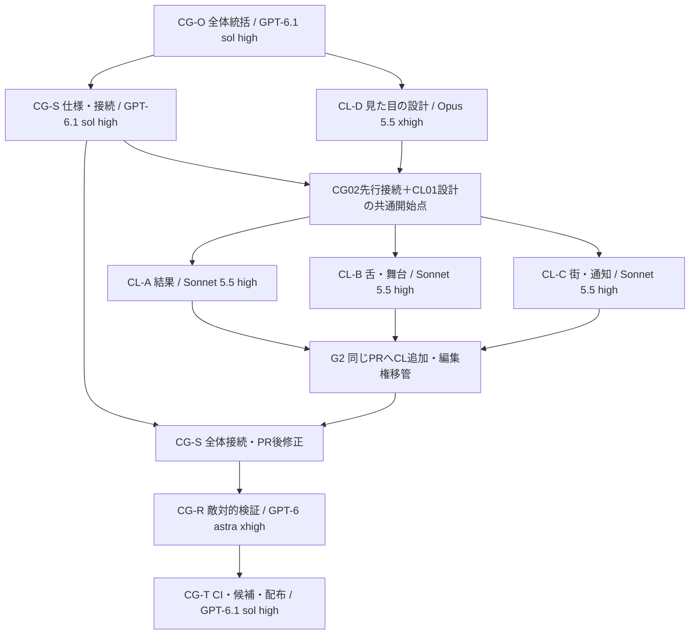

# ① カメレオる：全体実装計画書

2026-11-16。**Goal:** 通常起動したゲームを[全体要件](../specs/2026-11-16-chameleol-final-requirements.md)F01〜F14へ一致させる。**Architecture:** ChatGPTが仕様処理・接続・PR後対応、Claudeが描画/UI部品と提出前の確認を担当し、契約v1.2で結ぶ。個別計画は[②ChatGPT](./2026-11-16-chameleol-chatgpt-plan.md)と[③Claude](./2026-11-16-chameleol-claude-plan.md)。本書が担当・接続・ゲートの正本。

## 1. 完成までの順序と現在地

全体要件→本書→全体組織図→分担/契約→個別計画→敵対的検証→修正の順に作成した。製品の実装順はG0→G1→各部品→G2→G3→G4→G5→G6。#23の処理は再実装せず、通常接続と既存挙動の互換調整を追加する。#24のCIを保持する。部品完成と通常起動の完成、実機、公開は別の状態。

### 今回の共有PRの実行順（2026-11-16追記）

最新main `52a6be5aed194baf55e3ba4d77d286b90bab72bd`から専用ブランチ
`work/chatgpt-cg00-cg02-20261116`を作り、**ChatGPTのCG00→CG01→CG02を先にドラフトPRへ提出→Claudeが同じPR・同じブランチへCL工程の予定された描画/画面を追加→ChatGPTがCG03以降を統合**する。予定番号は#26、実際の番号・URL・準備commitは[受渡し票](../../acceptance/chameleol-handoff-ledger.md)を正とする。Claudeは新しいPRを作らない。全体統合までドラフトを維持し、本人に代わってマージしない。

先行PRの存在はClaudeの予定された機能追加をChatGPTへ移す意味ではない。役割・F要件・IF契約・ファイル分担は変えない。PR後のCI失敗・不具合・レビュー修正・コンフリクトは常にChatGPTが直接対応し、修正対象だけを一時ロックしてClaudeの書込を止める。再開時も最新headを照合し、force pushしない。CG02準備commitをCL02〜05の共通開始点に固定する。

## 2. ChatGPT＋Claudeの全体組織

| 役割 | 所属 | モデル | effort | 責任 |
| --- | --- | --- | --- | --- |
| CG-O 全体統括・境界管理 | ChatGPT | gpt-6.1-sol | high | 全体計画、契約、進行、取込、PR後対応を一元管理 |
| CG-S 仕様・処理・接続実装 | ChatGPT | gpt-6.1-sol | high | C処理の互換調整、App/保存/共有、通常接続、切替、PR後の表示修正も実装 |
| CG-R 敵対的検証・最終レビュー | ChatGPT | gpt-6-astra | xhigh | 担当間の穴、実データ、全体合格、PR後の失敗/競合を検証 |
| CG-T 試験・CI・配布確認 | ChatGPT | gpt-6.1-sol | high | 対象試験、4組CI、失敗修正、候補と版/切戻し |
| CL-O 描画側統括 | Claude | claude-opus-5-5 | high | 担当・競合・進行・提出前の管理 |
| CL-D 見た目の設計 | Claude | claude-opus-5-5 | xhigh | 構図・配置・姿勢・3寸法・資源の設計。製品コードは書かない |
| CL-A 結果画面の実装 | Claude | claude-sonnet-5-5 | high | V1/V4、カード・模型・回転・ports、共通CSS/結果アトラス |
| CL-B 舌と舞台の実装 | Claude | claude-sonnet-5-5 | high | V2、street/stage、mode選択、controller出力描画 |
| CL-C 街・警察・札の実装 | Claude | claude-sonnet-5-5 | high | V3、街アトラス、警察、bonus表示口 |
| CL-R 提出前の独立レビュー | Claude | claude-opus-5-5 | xhigh | 提出前の見た目と契約の確認。指摘修正は提出前のSonnet担当 |
| CL-T/W 提出前試験・記録 | Claude | claude-sonnet-5-5 | high / medium | 試験high、証拠の整理medium。提出後はCGへ移管 |

同時稼働は全体統括を含め4人以内。例：CG-O＋CL-A＋CL-B＋CL-C。CG01の後はCG02の先行接続とCL01の設計を並行し、CG02の準備commitと設計を共通baseへ揃えてからA/B/Cが実装を始める。設計・独立レビュー・試験/記録は終了した枠へ入れ、役割の数だけ同時起動しない。ChatGPT側も同じ上限を使う。各担当は同じ開始commitと契約版を使い、担当外ファイルへ同時に書かない。別サービス間の受渡しはPRと票を使い、自動で相手へ送ったことにしない。

ChatGPTのモデル名は現在の作業環境で使える名称を指定し、外部の有料API起動を意味しない。Claudeは[モデル一覧](https://platform.claude.com/docs/en/models/overview)、[model/effort設定](https://code.claude.com/docs/en/model-config)、[担当別設定](https://code.claude.com/docs/en/sub-agents)で2026-11-16に実IDと設定方法を確認した。例は`claude --model claude-opus-5-5 --effort high`。担当別にmodelとeffortを明示し、環境変数による上書き・利用不可を記録する。設定を偽らず、追加課金で代替しない。

## 3. ファイルの分担とPR後の移管

| 対象 | 予定された機能追加の書込担当 | PR後の問題対応 | 境界 |
| --- | --- | --- | --- |
| src/app.js、判定/保存/通信/共有制御、15辞書、catalog採否 | CG-S | CG-S | 通常接続と切替は常にChatGPT |
| result-card-ports/各結果描画、result-evidence-view、presentation.css、結果アトラス | CL-A | CG-S | CSSは予定追加ではAのみ。CL06追加提出後は書込停止→ChatGPTへ移管 |
| tongue-rig/travel-tongue/showcase-tongue、scene/street.js、stage.js | CL-B | CG-S | stage/streetはBのみ。Cの部品をBが取り込む |
| street-accents/actor-reactions/characters/hud-view/bonus-view、街アトラス | CL-C | CG-S | Cは描画と表示引数。仕様処理はCG。提出後はCG |
| 試験 | 実装担当→CL-T/CG-T | CG-T/CG-S | 同じファイルの同時編集なし。既存通常経路はG4まで維持 |
| 要件・契約・3計画・統合証拠・公開資料 | CG-O | CG-O | 担当変更は共通契約→個別の順に反映 |

**PR後の失敗・コンフリクトは、どちらのPRでもChatGPTの管轄。** CI失敗、既存試験の破損、不具合、レビュー修正、競合、候補作成失敗までCG-Oが追跡し、CG-S/Tが直接修正する。表示用のコード/素材/試験も対象。元Claude担当へ修正を返して待たない。Claudeは提出時に対象への書込を止め、ChatGPTが対象ファイル/開始head/修正branchを宣言する。仕様を変えず解消し、仕様判断が必要ならCG-Oが正本と照合する。

## 4. 担当間の契約 v1.2

2026-11-16のCL01設計票への回答と実装は[CG02補足受渡し](../../acceptance/chameleol-chatgpt-unblock-20261116.md)を参照。v1.2はsnapshotの画像借用、Appの画面寸法と札の抑止を明確化する追加で、工程ID・担当範囲は変更しない。

下表の「追加」はこれから作る接続であり、#23に存在することにしない。実装済みの細かな型は[接続票](../../prompts/2026-11-15-claude-pr23-handoff.md)とソースを照合する。契約変更はCG-Oが本書を先に更新し、両個別計画と試験の期待値も同時に更新する。

| 契約 | 生産側→消費側 | 関数/値 | 責任と確認 |
| --- | --- | --- | --- |
| IF01 v1.2 起動mode | CG-Sが選択、CL-Bが消費 | stage option presentationSet: legacy80(default) / extended96 | Claude段階の通常起動はlegacy80。実App試験のstageFactory wrapperだけextended96を指定。G4でChatGPTが通常Appをextended96へ。controllerが渡されたこと自体で起動しない。effects無効/簡易表示/ガイドでも既存経路を維持。 |
| IF02 v1.2 ゲーム中の値 | CG-Sが生成、CL-B/Cが描画 | options.gameExtrasController.step({...args.presentation, drawable, actorBusy:{hero,police}, placements:{railway,water,robot,bird,midpoint,policeSettled,existing}, reducedMotion:boolean}) | CL-Bが現在のprefers-reduced-motionの値をbooleanで毎回渡す。途中変更で舌を収納し、変更監視はscope/disposeで解除する。tはargs.presentation.t。extended96で舞台フレーム内に1回。legacy80は旧directorだけ、extended96は旧directorを止め、新controllerが旧小芝居も含め制御。controller方式のcameo:nullは非表示であり、旧directorへフォールバックしない。snapshot/event/disposeは既存APIを使用。DOM簡易表示のcreateDomStageもextended96ではdrawable:false・配置不可でstepを1回呼び、評価区間と札の処理を失わない。 |
| IF03 v1.2 結果ports | CL-Aが提供、CG-Sが接続 | 新規 src/presentation/result-card-ports.js: createResultCardPorts({result,host,scope}) -> ports | createResultPortrait/drawResultCard/createRenderer/destroyRenderer/mount/onChange/panelsを返す。Appの既存resultCardPortsへ渡す。snapshot.portraitImageはPNGと同じ現在の主人公画像の借用参照またはnullで、画面側は直接result.resultPortraitを読まず、変更/解放しない。初回onChangeはmountより先なのでlatestを保持し、mount時にcontroller.snapshot()を読む。Appで称号等を再算出しない。 |
| IF04 v1.2 所有者の先行準備 | CG-Sが生成、CL-Aが借りる | result.resultRendererOwner / acquire(kind,{signal,onRevoke}) | CG-Sがports取得後、controllerとmountより先にcreateResultRendererOwnerを準備する。CL-Aは最初の600msにも安全にE090を開ける。自前rendererを作らず、撮影優先時は解放して現在modelで再取得。 |
| IF05 v1.2 札の表示 | CG-Sが値を渡す、CL-Cが表示 | mountBonusPresentation().tick({precisionBadge,...})（追加する表示引数） | stage更新後snapshot().precisionBadgeを既存通知へ。Appはガイド/警告/警察1人以上/演出オフで通知値をnullにし、既存の警告優先を維持する。簡易DOMだけを理由に札を消さない。通知のためのstep追加なし。batch無しのeval中でも有効札は点数無しで表示し、guide/warningでは抑止。通常bonusのshow(batch)が札の開始時刻や表示状態を消さない。札の期限・閾値を描画側で再判定しない。 |
| IF06 v1.2 パネル更新 | CG-Sのcontrollerが通知、CL-Aが購読/表示 | ports.onChange(snapshot) -> main view + 開いているE075/E090 | factoryが購読/解除を所有し、確認状態だけの訂正でもmodel/miniatureを更新する。evidence更新だけに依存しない。パネルは初回panelsへ登録し、同時1つ。 |
| IF07 v1.2 共有・保存 | CG-Sが制御、CL-Aが操作画面 | controller.share/retry/getImageUrl/revokeImageUrl、mount({host,controller,scope,onTextShare}) | タップからshareを直接呼ぶ。生成待ちを挟まない。取消で本文窓を自動で開かない。保存を閉じたらURL解除、再試行で自動共有しない。AppはgetLayoutKeyの構図版と画面幅/高さを合成し、回転/寸法変更で旧Fileと保存URLを即無効にする。mountは既存.result-actionsの移動だけを行い、複製や既存ボタンへの二重イベント登録をしない。通常経路の本文共有試験はG4で同時に移す。 |
| IF08 v1.2 検証入口と採否 | CL-B/Cが部品検査、CG-SがApp入口 | 描画部品へsnapshot/固定姿勢 / App.debugPresentation / catalog | Claude段階はAppが拒否するIDを無理に通さない。G4で全16案が揃ってからcatalog96/4、Appの全対象入口、通常mode、共有試験を同じ統合commitで切り替える。 |
| IF09 v1.2 既存の背景抑止 | CL-Bが観測値、CG-Sが条件 | 追加step入力: frameIntervalMs:非負の有限ms、bestDistance:0〜50の整数またはnull。既存playViewとeventも消費 | CL-Bは進行中のpresentation.tの前回との差をframeIntervalMsとして返す。初回/停止/非表示/不正値は0。bestDistanceは既存setBestDistanceの値で、不正/欠損はnull。CG-Sが50<間隔<1000msを30連続で抑止、その他の間隔で連続数をリセットする旧条件を保持する。phase/警察段階/matchState/lastEvalSuccess/guideActive/guidanceActive/priority/building/passedとinstantSuccess/unlockBrightness/enterBuilding/passイベントを使い、既存の地区800ms・自己ベスト600ms・優先イベントの抑止も処理へ移す。別のlegacyCameoContextや第二の描画側抽選を作らない。 |
| IF10 v1.2 生涯と解放 | CG-Sが画面の生涯、CL各担当が所有物 | AbortSignal、scope、dispose、revision | 移動/再プレイ/言語/訂正/描画喪失/遅い完了で古い表示を復活させない。disposeは冪等。終了時にrenderer/画像/URL/購読/姿勢補正を戻す。 |
| IF11 v1.2 提出の単位 | ChatGPTが先行PRを作成、Claudeが同じPRへ追加、ChatGPTが受領 | 同じPR URL + head SHA + 受渡し票 + ファイル一覧 + 契約バージョン | CG02の準備commitから同じブランチへCL工程を追加し、新規PRは作らない。CL06の提出時に書込を止める。以後の失敗/競合/レビュー修正はCG04/CG07。画像ファイルであってもChatGPTが修正し、元担当へ返して待たない。 |

CG02の準備commitはAppオプションの実試験を可能にする共通土台で、通常起動の新演出はまだ有効にしない。CL01の設計はCG02と並行できるが、CL02〜04の製品実装とCL05の実App検査は同じ準備commitを含むbaseから始める。

IF09の入力名と型は上表を固定値とし、CG01が旧directorの全条件と照合して期待例を確定しCL01へ渡す。フィールドを変える必要がある時は契約を改訂し、片側だけで推測して実装しない。画面担当は配置/描画時間/既存反応の事実を返し、実際の抽選・発火・98%判定・保存取得はChatGPTに一か所だけ置く。

### CG01で照合したIF09の期待値

`frameIntervalMs`は有限・非負のみ有効（それ以外は0）。初回/停止/非表示は連続数を0にし、`50 < ms < 1000`だけ数える。29連続までは開始可、30連続で以後の新規背景開始を無効にし、既に取得済みの背景は通常の期限まで扱う。`bestDistance`は整数0〜50のみ、それ以外/欠損はnull。同じ値の毎フレーム入力で自己ベスト通過時刻をリセットしない。

| 旧経路から維持する抑止 | 境界・意味 |
| --- | --- |
| phase ended、policeStage>=2、matchState danger/success、lastEvalSuccess、guideActive/guidanceActive | 新規開始を止め、表示中/取得待ちの小芝居を取り消す |
| priority ending/danger/success/milestone/guidance | 同上 |
| 初期・地区入口1/20/23/30/40 | 800ms未満を抑止、800msで解除 |
| bestDistanceをpassedが初めて超える | 600ms未満を抑止、600msで解除。保存claim前に抑止し未表示の回数を消費しない |
| instantSuccess / unlockBrightness / enterBuilding(46〜50) | イベント時刻から450 / 600 / 800ms未満を抑止、ちょうど期限で解除 |
| 通常小芝居の機会 | graceへのphase遷移で1回。同じgrace内のbuilding変更で再抽選しない |

Appで生成するinstantSuccessも既存のsession由来イベントと同じcontrollerへ一度だけ渡す。スコア・履歴・署名summary・保存形式へ書き戻さない。舞台による観測値の実接続と画素/資源測定はCL03以降で確認する。

## 5. 受渡し票と完了条件

票は`docs/acceptance/chameleol-handoff-ledger.md`。一件ごとにF番号、IF版、担当、開始/完成commit、exportと呼出例、入力/出力、変更ファイル、対象試験、3寸法の画像、測定、未完了、PR URL/head、PR前→PR後の移管時刻を記録する。条件を満たさない票はCG-Oが理由を記録して直接解消し、受入済みと偽らない。

| ゲート | 合格条件 | 責任 |
| --- | --- | --- |
| G0 要件確定 | 本書とF01〜F14が対応、3計画の要件/契約/工程IDが一致 | CG-O |
| G1 契約と先行接続の確定 | CG01でIF01〜11を照合。CG02でmount前owner準備と札snapshot→bonusの橋渡しを先行実装し、legacy80を維持。準備commitを共通baseへ取り込んでからCL02〜04を開始 | CG-O、CL-Oが消費可能を確認 |
| G2 部品受入/共有PRへ追加提出 | 実装・App明示接続試験・3寸法・測定・提出前レビュー・受渡し票、PR headを固定 | CL-Oが同じPRへ追加提出、直後にCG-Oが引継ぐ |
| G3 PR後の問題解消 | すべてのPRの失敗/レビュー/競合をCGが解消し対象再確認、Claudeへ修正を返さない | CG-O/S/T |
| G4 通常接続と切替 | App ports/owner、stage mode、札、更新パネル、旧director置換、96/4、検証入口、共有試験を同じ統合commitで有効化 | CG-S |
| G5 全体合格 | 両者の実装完了後、CG05前段でChatGPTが15辞書をまとめて翻訳・再検査する。その後、正常/旧版/欠損/遅延/取消/同点訂正/停止/全16案・元80・27称号・15言語・資源を実データで照合、4組CI成功。翻訳前は合格にしない | CG-R/T |
| G6 実機と配布判断 | iPhone候補と版照合、実機項目、原画/不足、現行本番差分、切戻し、未確認一覧 | CG-O/T、最終マージ/公開判断は本人 |

## 6. ①から②③への対応

| 全体の作業 | ChatGPT計画 | Claude計画 | 完成の責任 |
| --- | --- | --- | --- |
| 要件・開始状態・契約 | CG00/CG01 | CL00/CL01 | CG-O |
| 結果の値・世代・共有／結果の描画 | CG02で共通土台→CG03 | CL02はCG02後 | CG-Sが通常接続しG5まで確認 |
| 発生条件・旧抑止／舌・背景・警察 | CG01/CG03 | CL03/CL04 | CG-Sが新旧切替まで確認 |
| 部品の提出前確認と共有PRへの追加 | CG02は統合試験を準備 | CL05/CL06 | PR前CL-O、提出後CG-O |
| すべてのPR後の失敗と競合 | CG04/CG07 | CL06で書込移管 | ChatGPT |
| 通常起動の接続と全体合格 | CG03/CG05 | CL05の証拠を入力にする | ChatGPT |
| iPhone候補と配布判断 | CG06 | CL06の画像/素材を入力にする | ChatGPTが用意、本人が判断 |

## 7. 試験と提出運用

工程途中は対象試験に絞る。最後の製品コード変更後に#24のchecks＋ブラウザ4組＋最終test/ビルドを完了する。新規e2eも自動対象、4組すべての成功記録を保つ。失敗・取消・skip・競合を成功扱いにせず、弱めて通さない。文書だけの更新で同じ全件を手動で追加実行しない。

PR提出後はCG04/CG07が、原因確認→対象ロック→修正→必要な再試験→同じheadのCI/競合再確認→証拠更新まで続ける。競合はmainの採用済み変更を保持して作業branchで解消する。無断のforce push、main直push、代理マージはしない。相手のbranchへ書込できない場合も修正branch/PRを作り、元PRとの関係を明記してChatGPTが完了まで担当する。

成果物は本書・②③・要件・レビュー、将来は接続済みゲームと受渡し票・全体試験・候補/切戻し。今回の資料PRをClaudeの実装完了と混同しない。
